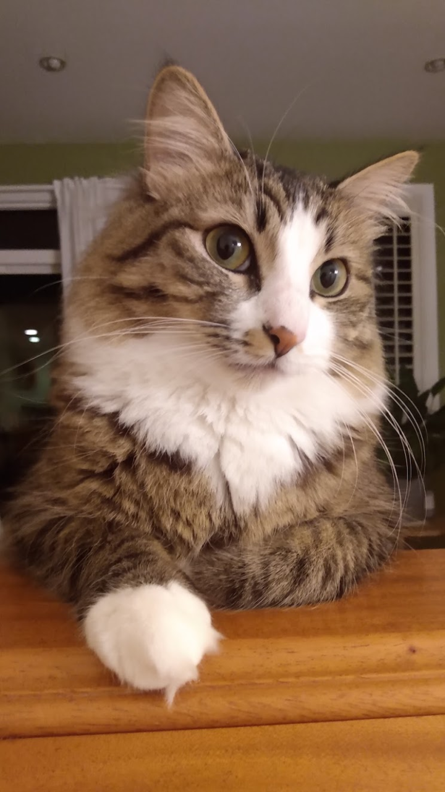
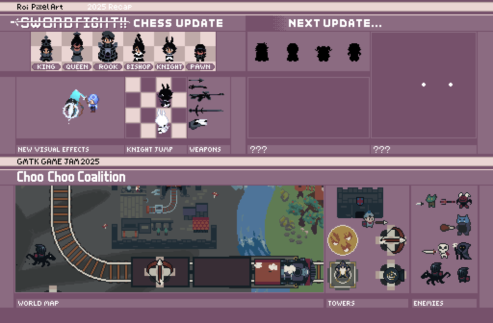
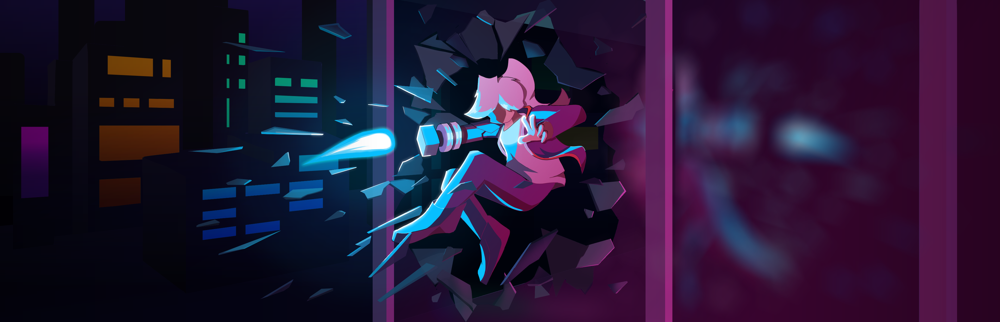

# About Me
Hi! I am **Roy Lee**, a third year computer science student at the University of Washington. This page details a little bit about me.
## Background
I am half Taiwanese, half Polish, and was born in America, which means I have 3 citizenships. In _theory_, that means I can speak three languages, but in practice I only know English and a little Mandarin and Polish. \
I live in Issaquah which means I tell people I'm from Seattle.

This is my cat named Kenji. \

## Programming
Besides working on programming assignments for classes, much of my programming experience is related to game development. My biggest project is a top down fighting game called [Swordfight!!](https://studio-19.itch.io/swordfight-pc) \
I've been working on games for over seven years and have submitted to every GMTK Game Jam since 2021. At this point it's like an annual event for me.

**GMTK Game Jam Submission Scores:**
| Year | Submission | Overall Placement |
| -------- | -------- | -------- |
| 2021    | Balloseum     | #1535     |
| 2022    | Roll With It     | #2981     |
| 2023    | Dungeon Developer | #851 |
| 2024    | Scale Mail Delivery Service | #743 |
| 2025    | Choo Choo Coalition | #203 |
| 2026    | VIRUS_DOWN!! | #150 |

_Note that placements for 2025 and 2026 were manually calculated as official overall scores were discontinued after 2024._

**Programming Languages:**
- C# (primarily with the Unity engine)
- Java
- JavaScript (primarily with node.js)
- Python
- C
- C++
- yeah i can read x86assembly instructions but don't ask me to code in it

## Art
I've made a good chunk of the assets for my games, including pixel art sprites, higher resolution renders, and occasionally music and sfx. \
Here is a sample of digital art I've worked on in the past.

When it comes to pixel art I mostly specialize in animation, especially relating to visual effects and character motion. \

This is the Steam banner for my in-progress game Kinetic Breakthrough (coming eventually). \

